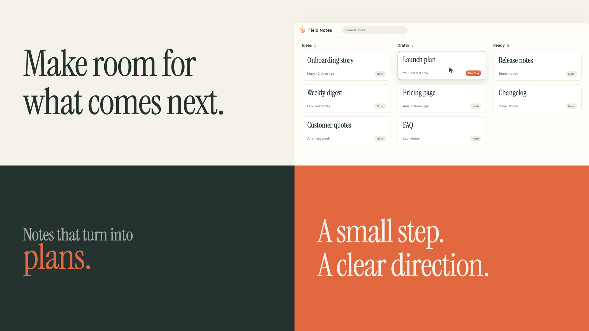
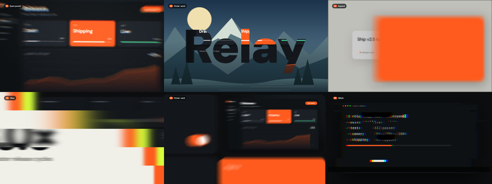
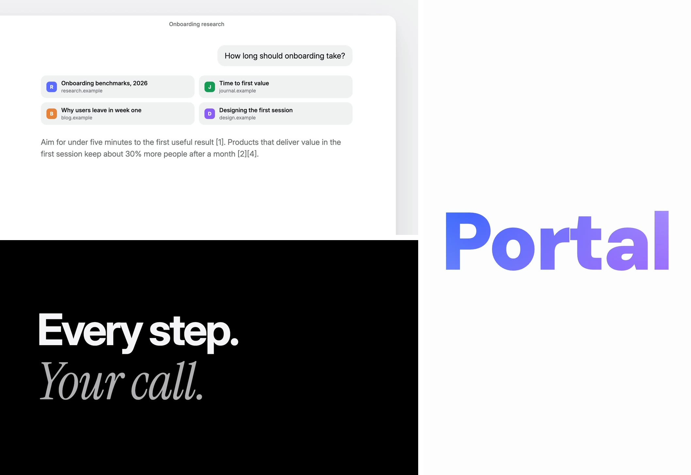
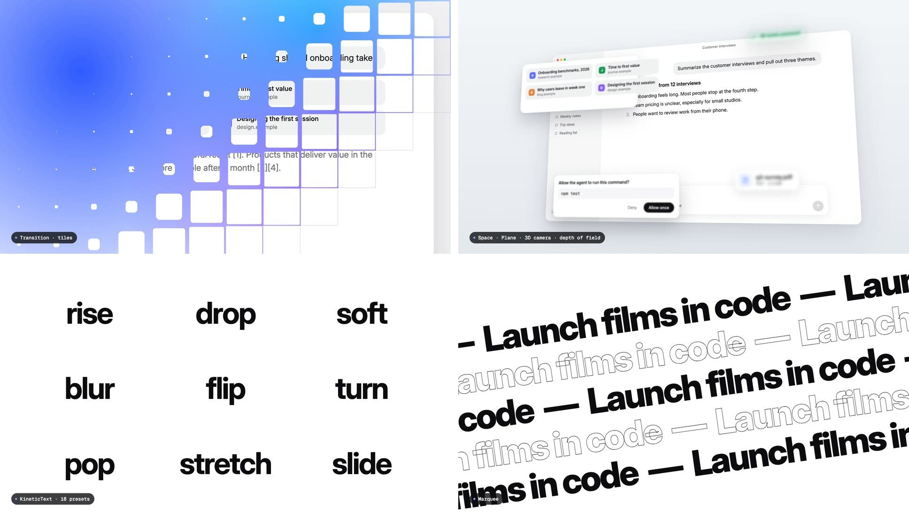
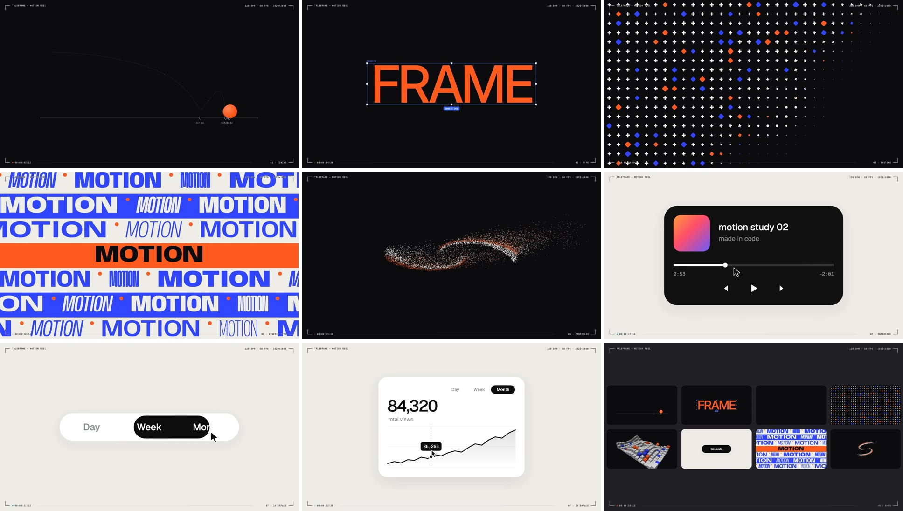

# Taleframe

A reusable library for product launches, app demonstrations, and motion reels. Build films with real UI, guided cameras, natural typing, kinetic typography, a motion vocabulary (springs, speed ramps, 3D space), scene transitions with true motion blur, and transitions and effects from Taleframe.

Films made with the kit follow one [film language](docs/film-language.md): a launch film, not a keynote. The agent reads the requested style and commits to it, lets type shots and UI shots take turns, uses big kinetic type, and cuts like an editor.

The kit is a Remotion project with editable examples and instructions for coding agents. Use it directly or ask an agent to turn your brief and assets into a film. It runs from this repository; no adjacent app or Taleframe checkout is required.











[Watch the sample films](https://github.com/dmitrykurash/taleframe-motion-kit/releases/tag/v1.3.0) or open the examples in Studio.

## Start with an agent

Clone this private repository with an account that has access, then open the folder in your coding tool:

```sh
git clone https://github.com/dmitrykurash/taleframe-motion-kit.git
cd taleframe-motion-kit
```

Give your agent this prompt, replacing the bracketed details:

> Read AGENTS.md and use the Taleframe skill in this repository. Create a [25-second product launch / UI demonstration / motion reel] for [product or subject]. The audience is [audience]. Show [two or three features or ideas]. UI source, screenshots, or recordings are at [paths]; brand assets are at [paths]. The style is [adjectives and references, e.g. "loud and bold, like a sneaker drop" or "calm and premium"]. Deliver [resolution, aspect ratio, frame rate], an MP4 preview, editable source, and the render command. Use the supplied UI to support product claims. Make reasonable implementation choices and complete the film, including visual checks.

Add a review point if you want to approve a storyboard or visual direction first. The kit does not force one approval process or one style on every film.

## Try it yourself

Install **Node.js 22 or newer**, then run:

```sh
npm ci
npm run studio
```

Choose a composition in Remotion Studio:

| Composition | What it shows |
|---|---|
| `Motion-Reel` | A 30-second 60 fps motion-design reel made with the kit: a bouncing ball, type under a selection box, pattern and block fields, a type wall, particle type, one UI shape morphing through twelve states, and a bento-grid recap |
| `Motion-Showcase` | A 66-second catalog: the newer scene transitions, 3D space, springs, camera moves, a speed ramp, all 18 type presets, and the type effects, each named by a label |
| `Product-Explainer` | A 52-second UX explainer for an unnamed AI workspace: four features, each a type card and then the product doing it |
| `Product-Launch` | A 26-second dark launch for the same product: word beats, a hero shot, a zoom into Allow, and a counter |
| `Kit-Reel` | A 31-second 1080 × 1920 reel about the kit, made with the kit; each scene transition names itself as it plays |
| `Scene-Transitions` | A 22-second reel of the five scene transitions between launch-film shots, with kinetic type |
| `Starter` / `UI-Demo` | A 24-second editable app demonstration with typing, results, settings, and a closing |
| `Launch-Film` | An 18-second launch in the editorial style: type and UI shots taking turns, a card portal, and an expand from Publish |
| `Motion-Catalogue` | Text, typing, camera, cursor, and badge recipes |
| `Transition-Gallery` | The included Taleframe shader transitions for pictures and footage |
| `Effects-Gallery` | The included image and canvas effect treatments |

Render the starter with its supplied settings:

```sh
npm run render -- Starter --props examples/starter.json --out out/starter.mp4
npm run preview -- out/starter.mp4 out/starter-preview.mp4
npm run verify -- out/starter.mp4
```

The first render downloads Remotion's dedicated Chrome. Media tools come from the pinned Remotion installation. See [quick start](docs/quick-start.md) for stills, custom props, and troubleshooting.

## What you can reuse

- A shot list (`Shots`) with hard cuts by default and fourteen scene transitions for React shots: `zoom`, `portal`, `expand`, `slice`, `glitch`, `stack`, `tiles`, `split`, `focus`, `liquid`, `tilt`, `cards`, `grid`, and `divide`.
- Temporal motion blur (`MotionBlur`) for transitions and any fast move, aware of speed ramps.
- A motion vocabulary: springs (including targets that change mid-flight and liquid edges), camera moves (glide, drift, spring, crash, whip), handheld wander and hits, arcs, stagger orders and grid waves, entrances for any element, speed ramps, rubber-band drags, a bouncing ball with squash and stretch, motion trails, and a 3D space for floating UI with depth of field.
- One shape, never cut: `Morph` carries a single element through many UI states with springs and blur content swaps, driven by a cursor.
- Motion-reel devices: a camera viewfinder frame, design-tool selection boxes, pattern fields, a 3D block field, and particle type.
- Logical stages for 16:9, 9:16, 1:1, and 4:5 outputs; the scene transitions adapt to each.
- Kinetic typography: 18 motion presets for lines, words, or letters (`KineticText`), type-to-type rolls and swaps, mask reveals, slams, word rolls, rapid word sequences, counters, scrambles, track-ins, and type effects: hand-drawn marks, marquees, type walls with variable widths, particle type, shine, circular text, split words, and variable-weight waves. Type is medium and filled by default.
- Camera keyframes, target framing, cursor paths, hover and click timing, and background parallax.
- Natural typing with repeatable key timing and a smoothly following camera.
- Word and character reveals, expanding badges, and closing sequences.
- 20 Taleframe shader transitions and 8 effects for pictures and footage, with galleries and adjustable settings.
- A frame-based workflow that renders correctly when seeking directly to any moment.

The starter demonstrates a fictional app. Changing its JSON personalizes that example; a film about a real app needs that app's UI source, screenshots, or recording. For a different story, layout, interaction, or duration, create a custom composition using the same library.

The supplied examples use Inter, DM Sans, Geist, Geist Mono, Anybody, and Instrument Serif. Replace fonts, colors, assets, pacing, and copy to fit your project. Effects are optional: a quiet background and a few precise movements can be enough.

## Project map

| Location | Purpose |
|---|---|
| [AGENTS.md](AGENTS.md) | Entry point for coding agents |
| [Production skill](.agents/skills/taleframe-motion-kit/SKILL.md) | Workflow and decision guidance |
| [src/kit](src/kit/index.ts) | Shared animation components and helpers |
| [src/examples](src/examples) | Editable film examples |
| [examples/brief.md](examples/brief.md) | A short brief template |
| [examples/starter.json](examples/starter.json) | Starter copy, brand settings, and output settings |
| `public/` | Local assets served to the renderer |
| `scripts/` | Preview, render, frame extraction, and verification tools |

Start with [film language](docs/film-language.md) for the rules every film follows, then [components](docs/components.md) to build shots, [kinetic type](docs/kinetic-type.md), [scene transitions](docs/scene-transitions.md), [motion direction](docs/motion-direction.md), and [app adapters](docs/app-adapters.md) for authentic UI. The [shader transition guide](docs/transitions.md), [effects guide](docs/effects.md), [video-footage guide](docs/video-sources.md), and [validation guide](docs/validation.md) cover their respective workflows.

Keep the full repository when handing it to another person or agent. Copying only the skill does not install the components, example assets, or renderer.

See [release checks](docs/release-checks.md) for what was tested, and [included assets and source](ASSET_NOTICES.md) for source records and dependency notices.
