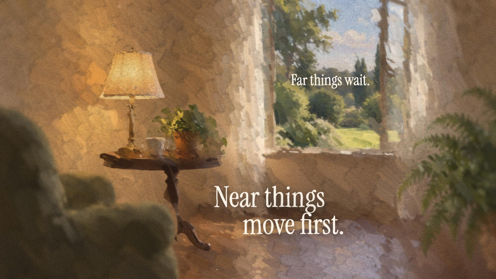

# Depth films

A depth film is a painted picture you can travel into. Each shot is a stack of painted planes at different depths, like a multiplane animation stand. A camera moves forward through the stack, so near planes grow and slide faster than far ones. Cuts pass *through* something in the picture: a lit window, a lantern, a doorway. Ink type is set into the scene, UI can float in depth, dust drifts between the planes, and a painted finish holds it together.

Use it when the film is made of pictures (paintings, stills, footage) and should feel handmade and deep. For product UI, statements and React scenes, use the [scene transitions](scene-transitions.md) and the [kinetic type](kinetic-type.md) components instead. The two can live in one project, not in one shot.

Everything below is in `src/kit/depth/` and renders through one canvas per frame. Shaders and effects need WebGL2, which both of the kit's renderers provide. Render with `--gl angle`, the hardware one, for speed: `--gl swangle` also works but is many times slower.

## The mental model

**Planes.** A shot is a stack:

| Plane | What it is |
| --- | --- |
| Plate | The whole picture at depth 1, with its cut-out subjects filled in (a push-pull wash of their surroundings), so parallax never reveals a hole. |
| Subject planes | Cut out by depth maps and tracked mattes, at depths between the plate and the lens (0.5 is halfway). |
| Foreground | A near plane when the picture has one: reeds, a window frame, a branch. |

Each plane is painted in its own space, before the camera moves. The strokes stay on their plane however far the camera travels, so there is no "shower door" effect.

**Camera.** `z` is forward travel in units of the plate's depth (0.3 is almost a third of the way in). `x`, `y` are sideways travel in stage pixels as seen on the plate, `roll` is in radians, and `fx`, `fy` is the point the camera travels toward (0..1 of the frame). A plane at depth `d` appears scaled by `d / (d − z)`: near planes grow faster. Sideways travel adds parallax.

**Clocks.** Pictures hold on twos (12 per second at 24 fps) for the handmade look, and so do the camera and the motes. Inside a cut the camera switches to the live 24 fps clock, so the travel-through is smooth. Copy always runs on the live clock, so its slow drift is continuous.

**Stage.** You author on a logical stage, 1920 × 1080 by default. Positions, sizes and blurs are in stage pixels. A 3840 × 2160 composition renders the same shots at twice the resolution; planes are painted at output resolution, so strokes and type stay crisp. The composition must keep the stage's aspect ratio and frame rate.

## A shot

```tsx
// src/examples/Lake.tsx
import React from 'react';
import {
  DepthFilm, anchorPoint, cameraPath, depthConfig, dustMotes, stillPlanes, trackedEllipse, type DepthFilmSpec,
} from '../kit/depth';
import {looseOil, paintedFinish, SWIRL_LENS, WATERCOLOR_BROAD} from '../kit/looks';
import tracks from '../../public/demo/depth/lake/tracks.json';     // the tools' anchors: sun, moorings

const config = depthConfig();                       // 1920 × 1080, 24 fps, on twos
const lake = stillPlanes('demo/depth/lake');        // color.jpg, <plane>.png, fill.jpg, fillmask.png
const moorings = anchorPoint(tracks.moorings, 0, config, {x: .2, y: .7});   // the jetty and the boat, stage px
const lakeCam = cameraPath([
  {t: 0, z: 0, x: 0, fx: .45, fy: .6},
  {t: 3, z: .14, x: -50},
  {t: 5, z: .34, x: -80, fx: .3, fy: .68},          // accelerate into the cut
]);

export const film: DepthFilmSpec = {
  config,
  shots: [{
    id: 'lake', window: [0, 5],
    paint: looseOil(WATERCOLOR_BROAD), lens: SWIRL_LENS,
    layers: [
      {id: 'plate', source: lake.plate({fill: true}), depth: 1},
      {id: 'trees', source: lake.plane('trees'), depth: .86, seed: 11},
      {id: 'mist', source: lake.plane('mist'), depth: .72, seed: 21},
      {id: 'moorings', source: lake.plane('moorings'), depth: .55, seed: 31, brush: .8,
        focus: [trackedEllipse(tracks.moorings, 0, config, .8)!]},
      {id: 'reeds', source: lake.plane('reeds'), depth: .4, seed: 41, ghost: true},
    ],
    camera: lakeCam,
    focus: () => .55,
    motes: [{after: 2, field: dustMotes({seed: 3, count: 50, depth: [.3, .9], focus: .55})}],
    lines: [{start: .5, end: 3.5, groups: [
      {text: 'Every picture', x: 1180, y: 330, size: 110, align: 'left', drift: [-20, 0], growth: 1.08, scrim: .4},
      {text: 'has a far side.', x: 1280, y: 470, size: 80, align: 'left', delay: .4, drift: [20, 0]},
    ]}],
  }],
  finish: paintedFinish(1),                         // the painted finish, scaled for 1080p
};

export const Lake: React.FC = () => <DepthFilm {...film}/>;

// src/index.tsx
import {depthFilmFrames} from './kit/depth';
import {film as lakeFilm, Lake} from './examples/Lake';

<Composition id="Lake" component={Lake} width={1920} height={1080} fps={24} durationInFrames={depthFilmFrames(lakeFilm)}/>
```

Keep the spec at module scope (or in `useMemo`). Pass it to `DepthFilm` inside a component, not as `defaultProps`: shots hold functions, which composition props cannot carry. Every function in a spec must be a pure function of its time argument.

## Shots and layers

| `DepthShot` | What it does |
| --- | --- |
| `id`, `window` | Name and visible window in film seconds, including the cuts on either side. |
| `layers` | The stack, far to near. The first layer is the plate. |
| `camera(t)` | The camera at film time t. Build it with `cameraPath`, `passage`, `matchCamera`. |
| `held(frame)` | Which held picture a film frame shows (footage). Default: a still, held frame 0. |
| `paint` | Watercolor or oil settings for every plane; `false` leaves them unpainted. |
| `tint` | A duotone grade applied before the paint, so the strokes carry it. |
| `lens` | The swirl lens on the shot's composite (`SWIRL_LENS`, `SWIRL_LENS_UI`). |
| `focus(t)`, `aperture` | Depth of field: the depth in focus, and the blur per unit of \|1/d − 1/f\| (default 2). |
| `motes` | Dust or embers, each drawn right after the layer with index `after`. |
| `guests` | Planes borrowed from another shot (see [Guests](#guest-planes)). |
| `ui` | UI layers in depth (see [UI in depth](#ui-in-depth)). |
| `lines` | Ink type that belongs to the shot (see [Type in depth](#type-in-depth)). |

| `DepthLayer` | What it does |
| --- | --- |
| `id`, `source`, `depth` | Name, pictures (below) and depth (1 = the plate, smaller = nearer). |
| `plate` | Keep it covering the frame and only mildly defocused. Default: true for the first layer. |
| `seed`, `brush`, `paint` | A different brush layout; a brush size multiplier (0.8 for subjects, a step finer than the plate); this plane's own paint. |
| `focus` | Oil focus ellipses in plane uv, fixed or per held frame (`focusEllipses`, `trackedEllipse`). |
| `look(t, scale)` | The plane's own motion: `grow`, `shiftX`, `shiftY`, `turn`, `alpha`, `blur`. `passLens(from, to)` melts a near plane as it reaches the lens. |
| `ghost` | Leave a heavily blurred colour wash of this cut-out on the plate. |
| `periphery`, `flipX` | Keep only the frame's edges (a haze bank that must never cross the copy); mirror the plane. |
| `frameOffset` | Borrow the picture from another film frame (a second haze bank from a different moment). |

**Pictures.** A `PlaneSource` returns paths under `public/` for a held frame: `color`, and `mask` for a cut-out plane, or `fill` and `fillMask` for a filled plate. `stillPlanes(dir)` and `footagePlanes(dir)` follow the folders the [preparation tools](#prepare-your-pictures) write. For footage, pass `held: heldFrames(frames.frames)` from the tools' `frames.json`: each film frame shows the latest extracted picture at or before it.

Painted planes are cached (16 by default, least recently used first out; `setPlaneCacheLimit`), and so are decoded images (48; `setDepthImageLimit`). Keep the plane cache above the number of planes one frame draws, cuts included.

## The camera

`cameraPath(keys)` runs each field through its own monotone curve (Fritsch–Carlson): it passes through every key, never overshoots, and keeps its speed through a key instead of stopping. A key may set only some fields. Accelerate into a cut with a bigger step in `z` over the last key or two.

For strong depth:

- use more planes, and stagger haze or cloud banks so the camera passes one after another;
- travel about twice as far forward as feels safe (`z` 0.3–0.5 over a shot), with some sideways travel;
- keep near planes near (0.3–0.5) and the plate at 1.

Plates get cover-scale overscan automatically: rolls, sideways travel and pull-backs never show their edges.

## Depth of field

Blur grows with aperture · |1/d − 1/f|, where d and f are the distances from the lens to the plane and to the focus plane. Plates are capped at 3 stage px so the backdrop never smears. Rack focus by animating `focus(t)`:

```ts
focus: t => .42 + (1 - .42) * depthEase((t - 3) / 1.5),   // from the near subject out to the sky
```

## Motes

`dustMotes` and `emberMotes` spread specks over a range of depths and project them through the shot's camera. They are the strongest depth cue a shot has: near ones stream past the lens and open into bokeh; far ones barely move. Embers rise and flicker; set `box` over the fire. Motes fade in and out over an optional `window`.

Keep whatever flies past the lens at the edges of the frame, so it never crosses the copy: a separate field of near specks with `periphery: true`, and a near plane (a haze bank, a branch) with the layer's `periphery: true`.

## Ghost fills

A cut-out subject that moves against its plate uncovers the fill behind it. With `ghost: true` the subject leaves a heavily blurred wash of its own colour where it stood, so what the parallax uncovers is its colour, softly. Use it only on front-row subjects (a row of reeds has more reeds behind it). On other subjects it reads as a double.

## Guest planes

A guest is a subject from the incoming shot, unmasked inside the outgoing one before its world appears. It is placed by its own shot's camera at its own depth, so when the cut completes it is already exactly where the incoming shot draws it.

```ts
guests: [{shot: 'room', layer: 'lamp', window: [4.2, 5.5], after: 1,
  reveal: t => ({cx: .6, cy: .4, radius: depthEase((t - 4.2) / .9) * .9}),
  alpha: t => smoothstep(4.2, 4.7, t), blur: t => 9 * (1 - smoothstep(4.2, 4.9, t))}],
```

Use `place` with `blendPlacement` to move a guest between two placements.

## Transitions on anchors

Every cut passes through something in the picture, on a beat. A cut mixes two shots with a [Taleframe shader](transitions.md) whose centre follows an anchor on screen. Six shaders take a centre: `watercolor`, `ink` and `engraving` for painted films, and `prism`, `ripple` and `godrays` for light ([travel through the picture](transitions.md#travel-through-the-picture)). Any other kind has no centre, and a cut that gives it a `center` stops with an error: `waterspill`, for example, washes in from an edge (its `direction` param), so give it none.

```ts
cuts: [{from: 'lake', to: 'room', window: [4, 5.2], shader: [4.2, 5.1],
  mix: {kind: 'watercolor', duration: .9, params: {count: 1, water: 30, pigment: 90, spread: 80, grain: 50, seed: 21}},
  center: t => anchorOnScreen(moorings, .55, lakeCam(t), config)}],
```

- The cut's `window` is on the live clock: both cameras run at 24 fps inside it. Outside the shader span only one side is drawn.
- Give both shots windows that cover the cut.
- The shader's progress is linear unless you pass `ease`: the cameras already ease through the cut.

**Open from the anchor.** `passage(camera, {open: {at, from}})` makes the incoming shot start pushed in at the point it opens from and ease back. `dive: {at, to}` makes a shot end by diving into a point.

**Match cut.** `matchCamera(target, anchor, depth, config)` is the camera that puts the incoming shot's anchor exactly on the outgoing anchor's screen position, radius for radius. Start on it and ease to the shot's own path with `lerpCamera`: the incoming shot starts pushed in so the two anchors coincide, then pulls back.

**Anchors.** The tools write tracks in frame fractions (`x`, `w` of the width; `y`, `h`, `r` of the height), one entry per held frame. `anchorPoint(track, frame, config, fallback)` gives stage pixels on the plane; `anchorOnScreen(point, depth, camera, config)` gives the screen position a shader centre needs. Missing frames use the nearest measured one.

## Type in depth

Ink type is composed into each scene as groups. Words surface out of the depth while a ragged wet front inks them in, with a small rack focus. Each group drifts slowly toward the viewer for its whole life: a continuous exponential zoom of about 10–14% about its own centre (or a pivot), on top of an optional slow drift. Groups leave upward, as pigment lifting off.

| `InkGroup` | What it does |
| --- | --- |
| `text` | A row, or rows as an array. |
| `x`, `y`, `align` | Anchor in stage px: x is the left edge, centre or right edge; y is the first baseline. |
| `size`, `lineHeight`, `tracking` | Font size in stage px (default 11% of the stage height), row spacing and tracking in em. |
| `delay`, `drift`, `growth` | Start after the line starts; steady drift over the group's life; approach (end ÷ start scale, default 1.1). |
| `pivot` | `'left'` or `'right'` for a group set against a border, so it grows away from it; or a point shared by groups. |
| `reveal` | `ink` (a wet front, default), `bloom` (a drop from the middle), `stamp` (down from near the lens). |
| `arrive` | `'right'` also slides the words in from the right. |
| `exit` | `lift` (default), `dissolve` (in place), `flight` (rising in arcs), `rush` (past the lens, full frame). |
| `scrim` | 0..1: a soft, wide darkening behind the group, for type over bright paper or sky. |
| `emphasis` | `[{word, kind: 'glint', at}]`: light crossing one word. |
| `font`, `color` | The face (default Instrument Serif) and the ink colour. |

A line (`InkLine`) holds groups with `start`, `end`, `seed` and the ink timing (`inDur`, `stagger`, `outDur`). With `depth` and `occlusion`, planes of the shot nearer than the line's depth pass in front of it. Lines in `overlay` belong to the film and are drawn over the mixed picture.

**Compose.** Give each scene its own arrangement: big and small, together and apart, placed around the subject so type frames the picture instead of covering it. Give a few lines their own gesture (a stamp, a flight, a rush past the lens, a glint), not all of them.

**Safe area.** No type in the outer 10% of the frame. On every frame, each visible word's real ink box (its glyphs' left and right edges, cap or ascender top and descender bottom) is checked where the word actually is: after the group's drift and approach and the word's own gesture (surfacing, a `stamp`, the `arrive: 'right'` slide, a `flight`, a `lift`). A word fainter than 5 % opacity is not yet, or no longer, read as type and is not counted. Any excursion is logged as a `SAFEAREA` console error with the text, the time and the box. A render must log none: count them with `npm run qa -- out/film.mp4 --log out/film.log`. Only a rush past the lens (while it leaves) and a group with `safeArea: false` (a deliberate full-frame effect or an off-screen entrance) are exempt.

`safeAreaViolations(lines, {config})` scans lines over their whole lives without rendering. In the browser it measures with the canvas (load the fonts first with `loadInkFonts`); in Node pass your own `measure(text, font, tracking)`.

**Placing from a wireframe.** When a reviewer marks screenshots with red text, register each screenshot to the frame, measure the red letters (edges, cap top, baseline) and set size = (baseline − cap top) ÷ the font's cap height in em. Nudge anything inside the border just inside it. The tools are in `tools/depth/wireframe/` and `tools/depth/measure_font.py`.

**Fonts.** Canvas text does not wait for fonts, so `DepthFilm` loads every face its lines use before the first frame. Import the face with Fontsource (the kit's `src/index.tsx` imports Instrument Serif) or add an `@font-face`. A face that does not load stops the render with its name.

## UI in depth

A UI layer is a full-frame transparent picture floating in front of the painting: a card, a dialog, a window.

| Source | Use |
| --- | --- |
| `uiSequence({directory, frameCount, fps, start, poses})` | A transparent PNG sequence (`frame-000000.png`…) rendered from a UI composition (below). Frame 0 plays at `start`. `poses` is its per-frame log (stage px) of the layer's own camera and the anchor to dive through. |
| `uiDrawing((ctx, {t}) => …, pose?)` | A deterministic drawing in stage px. |

```ts
ui: [{source: card, window: [7, 11], enter: {at: 7.1, dur: .6}, exit: {at: 10.2, dur: .7, kind: 'dive'}}],
focus: uiFocus(ui, {scene: .7, ui: .3}),
```

- `enter`: the layer arrives out of the depth, small, soft and faint, settling into place.
- `exit: 'pass'`: it grows toward the viewer and fades. `exit: 'dive'`: the camera flies through it at its anchor (a button, a badge, a window), and the next scene opens from that point. Centre the cut on `uiAnchor(layer, t, config)` and open the next shot with `passage` from the same point.
- `uiFocus` pulls focus from the painting to the UI while it is present.
- `followUICamera(source, {from})` moves the painting's camera with the UI's own logged camera at reduced rates, so an exported product move gains parallax.

**Export a UI moment as a sequence.** Build the moment as its own composition at the stage size and the film's frame rate (1920 × 1080, 24 fps), with its own camera, typing and cursor, and leave its background empty. Render it to PNGs with Remotion's CLI, then copy the frames to the names `uiSequence` reads:

```sh
npx remotion render src/index.tsx Card-Moment out/card-moment --sequence --image-format png
mkdir -p public/ui/card-moment
i=0; for f in out/card-moment/element-*.png; do cp "$f" "public/ui/card-moment/frame-$(printf %06d $i).png"; i=$((i+1)); done
```

PNG keeps the alpha wherever nothing paints, so the empty background stays transparent. Remotion pads every frame number to the same width, so the loop copies the frames in order.

Log the poses from the same pure functions the composition moves with. `poses.json` maps a sequence frame to the layer's own camera (`x`, `y`, `scale`) and the point a dive goes through (`anchorX`, `anchorY`), in stage px. A frame you leave out uses the nearest one listed.

```json
{"0":  {"x": 960, "y": 540, "scale": 1,    "anchorX": 1180, "anchorY": 610},
 "48": {"x": 930, "y": 532, "scale": 1.12, "anchorX": 1196, "anchorY": 618},
 "95": {"x": 900, "y": 524, "scale": 1.25, "anchorX": 1212, "anchorY": 626}}
```

A composition cannot write files, so write the log with a small script that imports the composition's camera function (here `cardPose(frame)`, returning a `DepthUIPose`), and run it with `npx tsx scripts/card-poses.ts`:

```ts
// scripts/card-poses.ts
import {writeFileSync} from 'node:fs';
import {cardPose} from '../src/examples/CardMoment';
const poses = Object.fromEntries(Array.from({length: 96}, (_, frame) => [frame, cardPose(frame)]));
writeFileSync('public/ui/card-moment/poses.json', JSON.stringify(poses));
```

The film then reads both:

```ts
import poses from '../../public/ui/card-moment/poses.json';
const card = uiSequence({directory: 'ui/card-moment', frameCount: 96, fps: 24, start: 7, poses});
```

Headings and UI are separate beats: the heading, then the UI element, then the next scene. If a UI beat needs more time, take it from the neighbouring shots; never overlap them.

**Verification as proof.** A checking element can prove itself on screen: it opens in a checking state, adds its checks one by one (the panel grows taller with its top fixed; each row spins, then settles), settles on the verified state, and then the camera dives through it. Give it its own beat after its heading.

**A custom cursor** inside a UI layer: put the hotspot on the tip, give it a soft drop shadow, and show it at a fixed logical width.

## Looks

A depth film runs the painted-film chain:

1. a per-shot duotone `tint`, before the paint;
2. the paint, per plane: watercolor, or oil (`oilStyle`, `looseOil`; see [Paint in oil](effects.md#paint-in-oil));
3. the swirl `lens` on each shot's composite;
4. the `finish` once on the whole frame: stopmotion at 12 fps (jitter, rotation, boil, texture), soft-light grain, a light duotone. Use `paintedFinish(scale)` with the output scale (1 at 1920 × 1080, 2 at 3840 × 2160, `outputScale(config, width, height)` in a component); `PAINTED_FINISH` is the same finish at 4K.

With oil, give each plane with a hero (a face, a hand, a lit window, the prop the scene is about) a `focus` ellipse: fine strokes gather there and the rest can stay loose. Paint subject planes a step finer than their plate (`brush: .8`). `DepthFilm` loads the oil brushes itself.

`forceWatercolor: true` paints every oil plane with its watercolor settings instead: one flag keeps an earlier watercolor version reproducible. Read it from input props to switch at render time.

## Prepare your pictures

Planes, fills and anchor tracks come from the Python tools in `tools/depth/`: held frames, depth maps (Depth Anything V2), tracked mattes (SAM 2.1 and BiRefNet), plane masks with push-pull fills, anchor tracks, and still paintings cut into planes. See [tools/depth/README.md](../tools/depth/README.md) for setup and commands.

| Picture | Files the tools write | Source helper |
| --- | --- | --- |
| A still painting | `<dir>/color.jpg`, `<dir>/<plane>.png`, `<dir>/fill.jpg`, `<dir>/fillmask.png`, `<dir>/tracks.json` | `stillPlanes(dir)` |
| Footage | `<dir>/frames/f0048.jpg`, `<dir>/planes/<plane>/f0048.png`, `<dir>/fill/f0048.jpg`, `<dir>/fillmask/f0048.png`, `<dir>/frames.json`, `<dir>/tracks.json` | `footagePlanes(dir)` + `heldFrames` |

Generate planes for exactly the held frames the edit uses.

**Cut honestly.** Do not cut out a subject whose matte is imperfect (a spinning wheel, smoke, wisps of hair against the sky) or whose parallax would be negligible (it sits at the sky's depth). The cut leaves a ghost of the subject and a blurry filled patch that viewers notice. Leave it in the plate and keep it out of the plate's fill. A still painting behind UI often reads best uncut, as one plate that moves as a piece.

## Render

- Render with `--gl angle` for speed. Transitions and paint need WebGL2; `--gl swangle`, which `npm run render` uses by default for repeatable shader output, also provides it but renders many times slower.
- Painting is the slow part: about 0.1–0.7 s per plane and held frame at 4K. On twos, each picture is painted once and reused for two frames.
- Before blaming your shots for a slow render, check whether another app holds the GPU (`ioreg -r -d 1 -c IOAccelerator | grep "Device Utilization"` on a Mac).
- `renderDepthFrame(ctx, film, frame, scale)` draws one frame into any canvas, for tests and tools. `DepthCanvas` is the canvas component underneath `DepthFilm` for your own frame renderers.
- For long masters, QA and chunked renders, see [validation](validation.md#check-a-long-master).

## Example film



`Painted-Depth` is a 22-second depth film made from the three demo paintings in `public/demo/depth/`. The component is [`src/examples/PaintedDepth.tsx`](../src/examples/PaintedDepth.tsx). The film itself is data in [`src/examples/depth/film.ts`](../src/examples/depth/film.ts), and the render-status card is a drawing in [`src/examples/depth/card.ts`](../src/examples/depth/card.ts).

```bash
npm run render -- Painted-Depth --gl angle --out out/painted-depth.mp4
```

To paint every plane in watercolor instead, pass `--props` with a JSON file that holds `{"watercolor": true}`.

| Seconds | Beat | What it uses |
| --- | --- | --- |
| 0–5.3 | A lake at dawn | Five planes in loose oil (plate, trees, mist, jetty and boat, reeds). Forward travel with a little sideways drift, a rack focus from the far shore to the boat, dust, and two ink groups set apart; the small one leaves in `flight`. |
| 5.3–6.6 | Through the sun | The lake's camera dives into the sun (`passage`). A `watercolor` cut centred on the sun opens the room, which starts pushed in on its window, placed exactly on the sun (`matchCamera`), and pulls back. |
| 6.6–10 | The sitting room | The heading: two big groups over the floor, one small group over the garden, the far thing. |
| 10.15–13 | The card | A render-status card (`uiDrawing`) arrives out of the depth, adds its four checks one by one and settles on its ready state. Focus pulls to it (`uiFocus`). |
| 13–14.2 | Through the card | The camera dives through the card's badge. An `ink` cut centred on the badge (`uiAnchor`) opens the harbour from the same point. |
| 14.2–22 | The harbour at dusk | Travel toward the lighthouse, a rack focus from the harbour wall to the lighthouse, sea-mist specks, a `rush` exit, then the title with a `stamp` and a glint. |

At 1920 × 1080 with `--gl angle` it renders in about a minute on an M3 Pro, because still paintings are painted once per browser tab. The render logs no SAFEAREA. Its held pictures are as steady as the watercolor version: `tools/qa/steadiness.py` gives a ratio of 0.99–1.05 per shot.

What the example taught:

- **Sideways travel shows plane edges.** A cut-out that touches a frame edge (reeds, an armchair, a fern) keeps covering it only while its growth outruns the sideways travel. Keep `x` below `(1 − fx) · width · z` for planes on the right edge and above `−fx · width · z` for planes on the left edge. Treat `y` the same way for the bottom and top edges. The rule holds at every depth, so check it once per camera key.
- **A luminance key is not a haze plane if things stand in the haze.** The harbour's mist matte has holes where the mooring post and the boat stand. At the mist's depth the holes drift off their subjects and read as a darker second post, so the harbour leaves its mist plane out. Look at a haze matte over a flat colour before you use it.
- **Ghost fills double clear outlines.** On an armchair's arm or a mooring post, the ghost wash reads as a soft second chair and a second post. Keep `ghost` for front rows whose outline is texture, such as reeds or grass. Elsewhere the plate's own fill is quieter.
- **Pull focus to UI gently.** A strong pull blurs a lamp into a glow, and the wall's sharp pool of lamplight beside it then reads as a second lamp. The room pulls to `ui: .45` with `aperture: 4`.
- **Scale the finish with the output.** The painted finish's jitter, boil and grain are measured in output pixels and tuned at 3840 × 2160, so at 1080p they read twice as strong. `paintedFinish(scale)` from `looks.ts`, which the example uses, halves jitter and boil at 1080p, makes the grain about 1 px (1.15 instead of 2.3) and lighter (amount 0.20 instead of 0.37), and leaves 4K unchanged.
- **Give each scene's hero a focus ellipse.** Loose oil lays the same strokes relative to the frame at any size, and outside the focus regions a landscape loosens a lot. The boat, the lamp, the window and the lighthouse carry ellipses from `anchors.json`, so they keep their detail.
