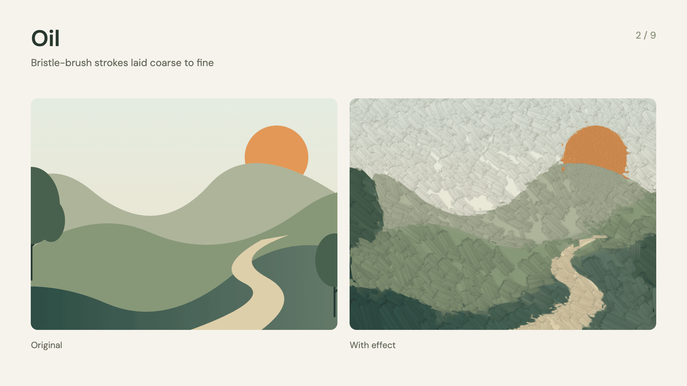

# Add a look to a scene

The kit includes eight effects from Taleframe. They are off until you turn them on. You do not need a Taleframe checkout or its editor.

Start with one effect. Keep interface labels and small text clear: place those elements above the effects layer.


```tsx
import {staticFile} from 'remotion';
import {TaleframeEffects} from '../kit/TaleframeEffects';

<TaleframeEffects
  source={staticFile('my-background.jpg')}
  effects={{watercolor: {enabled: true, amount: 1, paper: 0.4}}}
/>
```

This adds watercolor only. It does not add film grain, stopmotion, or other finishing effects.

| Effect | What it does | Useful controls |
| --- | --- | --- |
| `watercolor` | Rebuilds the image with brushwork and paper, or in oil with `style: 'oil'` ([below](#paint-in-oil)) | `amount`, `brushSize`, `strokes`, `detail`, `wetness`, `paper`, `seed` |
| `pigment` | Adds color settling and granulation | `amount`, `granulation`, `settling`, `paper`, `seed` |
| `helios` | Keeps a focus area sharp and swirls the blurred surroundings | `blur`, `swirl`, `focusX`, `focusY`, `focusRadius`, `focusFeather` |
| `grain` | Adds a repeatable film texture | `amount`, `size`, `monochrome`, `animated`, `speed`, `blend` |
| `chromatic` | Separates red and blue edges | `strength`, `angle`, `radial`, `redBlue`, `blur` |
| `lens` | Distorts and zooms the image | `distortion`, `zoom` |
| `duotone` | Maps the image to two colors | `amount`, `shadows`, `highlights` |
| `stopmotion` | Holds source frames and optionally adds handmade movement | `fps`, `jitter`, `rotation`, `boil`, `texture`, `exposure`, `seed` |

Use `enabled: true` on each effect you want. Leave other controls out to use the native defaults. `amount: 0` bypasses effects that have an amount control. All seeds are fixed unless you change them.

To combine effects, pass them together. The order runs from first to last:

```tsx
effects={{
  order: ['helios', 'watercolor'],
  helios: {enabled: true, blur: 35, swirl: 0.5},
  watercolor: {enabled: true, paper: 0.4},
}}
```

This blurs the image before painting it, keeping the final brush texture clear. Unlisted effects keep their usual position and remain off unless enabled.

## Paint in oil

The watercolor effect has a second style: oil. The same reconstruction is painted with opaque bristle-brush strokes, laid coarse to fine. Add `style: 'oil'` to the watercolor settings. Leave it out and you get watercolor, exactly as before.



```tsx
import {TaleframeEffects} from '../kit/TaleframeEffects';
import {oilStyle} from '../kit/oil';
import {WATERCOLOR_BROAD} from '../kit/looks';

<TaleframeEffects
  source={staticFile('lantern.jpg')}
  effects={{watercolor: oilStyle(WATERCOLOR_BROAD, {strokeScale: 2, looseness: 2.4, focus: [[0.62, 0.4, 0.08, 0.12]]})}}
/>
```

`looseOil(watercolor, focus)` from `looks.ts` is the same thing with `strokeScale: 2` and `looseness: 2.4`: bold strokes and a loose picture that still keeps its focus regions sharp.

| Control | Range | What it does in oil |
| --- | --- | --- |
| `style` | `'oil'` or absent | `'oil'` paints with bristle-brush boxes. Absent means watercolor. |
| `strokeScale` | 0.25–8, default 1 | Size of every stroke, relative to the brush preset. 2 is twice as long and twice as wide, with about a quarter as many strokes per level. |
| `looseness` | 1–8, default 1 | Less detail outside the focus regions. Finer strokes need more error to appear there, and the two finest levels are thinned. 1 lays every stroke the picture asks for. |
| `focus` | up to 4 ellipses | Where fine strokes gather: `[cx, cy, rx, ry]` in frame coordinates from 0 to 1, top-left origin. `oilStyle` takes a list of tuples or a flat list. |
| `brushSize` | 0–4 | The brush cell every level is measured from. Larger is broader. |
| `detail` | 0–4 | Sharpens the underpainting and brings back fine accents from the picture at output resolution. 0 keeps the paint pure. |
| `edgeScale` | 0–4 | Strokes grow toward the frame edge. |
| `seed` | integer | The stroke lattice. Keep it to keep every stroke where it is. |
| `amount` | 0–1 | Mix with the original picture. |

`wetness` and `paper` have no effect in oil: there is no wet edge, edge darkening or paper relief. `strokes` only shapes the watercolor brush.

Oil needs its two brush images. `<TaleframeEffects>` loads them for you. If you call `applyTaleframeEffects()` from your own canvas renderer, await `loadOilBrushes()` once before the first oil paint, inside your own `delayRender` flow. Without it the engine throws an error instead of painting.

```ts
import {loadOilBrushes} from '../kit/oil';

await loadOilBrushes();                       // memoised; a failed load rejects and can be retried
applyTaleframeEffects(ctx, {watercolor: looseOil()}, frame, fps);
```

### How the stroke works

The stroke follows the oil stroke of Stylized Neural Painting (Zou et al., CVPR 2021). It is implemented from the paper on the engine's own lattice.

- Each lattice cell lays one rotated box along the local structure of the picture.
- A bristle brush textures the box. The brush luminance multiplies the colour, and the brush mask is the alpha.
- The colour runs from C0 to C2 along the stroke. Both are sampled from the picture at the two ends of the stroke's axis. An end that falls in another colour region leans back to the centre colour, so a stroke never drags one region's colour into another.
- Boxes shorten where the colour changes along them, and narrow where they would straddle another colour.
- Strokes are opaque and land coarse to fine, on four levels at 1, 0.45, 0.2 and 0.1 of the brush cell. Each level draws its cells in a scattered order, so overlapping strokes never stack in rows.
- A box whose area is over a tenth of the frame height squared uses the large brush; the rest use the small one.

### Why faces read

Each finer level paints only where the painting so far is still wrong. Between levels the engine takes a snapshot of the canvas and compares it with the picture. A finer stroke appears only where that difference is above a per-cell threshold. This is the paper's progressive refinement, done live on every frame.

Gating fine strokes by image edges alone leaves faces a blur. With the residual gate, eyes, noses and hands keep failing the coarse levels, so the fine strokes gather there by themselves.

Focus ellipses make this deliberate. Inside one, the thresholds drop to 35 % of their usual value, so detail gathers there. Put them on faces, hands, eyes, and the one prop a scene is about. Everything else can loosen. In a depth film, paint subject planes a step finer than the plates behind them.

`looseness` is how you loosen the rest. Raising the thresholds alone barely changes the picture, because fine strokes sit on strong edges anyway. What reads is thinning: outside the focus regions a cell keeps its accent stroke with probability 1/looseness and its detail stroke with 1/looseness², decided once per cell. Focus regions keep every stroke.

### Resolution and speed

Strokes are laid on a canvas at the output resolution, seeded with the upsampled underpainting, so edges and bristles stay crisp at 4K. The analysis passes (guide, structure, flow, underpainting) stay on a 1080p grid. Running them at 4K costs about four times the work for no visible gain. Laying the strokes at 1080p blurs the bristles.

A 4K plane paints in about 0.1–0.65 s, in the same range as watercolor.

### Steadiness

Stroke positions come from the seeded lattice in the picture's own space, so they hold across held frames while their colour follows the current frame. In `Painted-Depth`, oil measured 0.99–1.05 per shot against a watercolor render of the same edit: the change between held frames matches. Measure your own film with `tools/qa/steadiness.py`.

A live style also beats an offline stroke bake. A bake that solved strokes per keyframe needed hours per revision; the live style repaints in the render.

### Brushes and licence

The brushes are our own and procedural: clumped bristles with ragged ends, a loaded start and a drier end, and soft tips. They have no dry-brush holes, which read as dark specks over darker paint. They have no dark rim: under the soft mask edge the luminance is bled to the stroke's mean.

They live in `public/taleframe/oil/brushes/` (R = luminance, G = mask). The engine uses the two horizontal brushes and builds its own mipmaps. Regenerate them with `.venv/bin/python tools/oil/brushes.py`, or `npm run oil:brushes` with the environment active (numpy and OpenCV; see [oil brushes](../tools/oil/README.md)). The output is deterministic.

Stylized Neural Painting's code, neural renderer checkpoints and brush images are licensed CC BY-NC-SA. None of them is used or shipped here.

### Keep watercolor

Oil is one flag. Remove `style: 'oil'` and every shot paints in watercolor again, with the same settings, the same seeds and the same pixels as before. Keep that flag in one place (a constant in your film) so an earlier look stays one change away.

## Named looks

`src/kit/looks.ts` holds presets for painted films. Spread one to change a control: `{...WATERCOLOR_BROAD, seed: 7}`.

| Look | What it is |
| --- | --- |
| `WATERCOLOR_BROAD` | Wide brushes, moderate wet edges, strong paper, strokes that grow toward the edge. Landscapes, rooms, background plates. |
| `WATERCOLOR_FINE` | A small, very wet brush. A busy subject whose shapes must survive. |
| `LOOSE_OIL`, `looseOil()` | Oil with `strokeScale: 2` and `looseness: 2.4`. |
| `TIGHT_OIL` | Oil at the preset's stroke size, every stroke the picture asks for. |
| `SWIRL_LENS` | Helios with a wide sharp centre and a soft swirled edge, for painted plates. |
| `SWIRL_LENS_UI` | A sharper focus edge with more blur and swirl, for a product UI layer. |
| `PAINTED_FINISH` | Stopmotion at 12 fps with handmade jitter, rotation, boil and texture, then soft-light grain, then a light duotone. Tuned at 3840 × 2160. |
| `paintedFinish(scale)` | `PAINTED_FINISH` scaled for the output (1 = 1920 × 1080, 2 = 3840 × 2160; at 2 it equals `PAINTED_FINISH`). At 1080p it halves jitter and boil and makes the grain finer and lighter. |

`paintEffects(watercolor)`, `lensEffects(helios)` and `tintEffects(duotone)` wrap a look as settings for `applyTaleframeEffects()`.

A painted film runs them in this order:

1. an optional duotone tint per shot, before the paint, so the brushwork carries the grade;
2. the paint, per plane (watercolor or oil);
3. the swirl lens on the composited frame;
4. the painted finish, once, on the whole frame.

See [depth films](depth-films.md) for a compositor that runs this chain for you.

## Animate the source

For moving backgrounds or a canvas scene, pass a draw function. It gets the exact frame and time to draw. Use these values for every animation; do not use `Date.now()` or `Math.random()`.

```tsx
<TaleframeEffects
  source={{draw: (ctx, {width, height, seconds}) => {
    ctx.fillStyle = '#f3eee3';
    ctx.fillRect(0, 0, width, height);
    ctx.fillStyle = '#ca6b4a';
    ctx.beginPath();
    ctx.arc(width * (0.5 + Math.sin(seconds) * 0.2), height / 2, 120, 0, Math.PI * 2);
    ctx.fill();
  }}}
  effects={{stopmotion: {enabled: true, fps: 12, jitter: 0, rotation: 0, boil: 0, texture: 0}}}
/>
```

The source really holds at 12 poses per second. The exported video keeps its normal frame rate. In the draw function, `frame` and `seconds` use this held clock; `outputFrame` is the actual export frame. The handmade texture controls are separate and can all be zero.

The draw function may be async. Load assets before drawing and resolve when the frame is complete. You can composite multiple images or a decoded video frame here. If you already own a canvas renderer, call `applyTaleframeEffects(ctx, effects, frame, fps)` after drawing that frame. Rebuild the source pixels on every call, so effects do not accumulate.

## What is supported

- Images: file URLs from `staticFile`, inline data URLs, or remote images with the right CORS headers. Images fill the frame by default. Use `{src, fit: 'contain', background: '#fff'}` to show the whole image.
- Canvas scenes: the draw function above, including animated images, shapes, and text.
- Video: use the included [video-footage helper](video-sources.md) to extract frames and pass them into this component. The wrapper itself does not decode a movie or capture a DOM video element.
- HTML/React UI: layer it on top to keep it clear. To process it too, first render it into an image or draw the UI into the source canvas.
- Watercolor: native spatial brushwork is included. Taleframe's separate optical-flow analysis for paint that follows objects across video frames is not included. Frame-by-frame video can show changing brush detail; use a gently moving still when that matters.
- Helios: an image effect with a chosen focus region. It does not calculate real scene depth.

Watercolor, pigment, and Helios require WebGL2. Use the kit render script with its configured graphics mode. A missing graphics context produces an error instead of quietly skipping the effect. The simpler finishing passes also have a CPU fallback. Keep source images within the graphics card's texture limit.

The `Effects-Gallery` composition shows each effect beside the original, plus the oil style. It shows nine pairs, 3 seconds each (`EFFECTS_GALLERY_SECONDS`). Its final scene demonstrates both held movement and surface texture. Check a rendered sample at the final resolution before a long export.

The copied runtime and its source hashes are recorded in `src/taleframe/effects/PROVENANCE.json`. The wrapper uses a small subset of Taleframe's types and sample-time helpers; it does not bring in the editor or project storage.

## Repeatable renders

Use `--gl swangle` when you need the same watercolor pixels after every seek. It uses the portable software graphics path and is slower. Our checks compare a frame, a different source pose, then the original frame again; all eight effects repeat exactly in this mode.

Hardware `--gl angle` is faster. On the tested Mac it produced small differences in watercolor's fine brush passes after a seek. It still renders the same style, but do not use it when exact frame repeatability matters. No effect relies on a wall clock or an unseeded random value.

Oil repeats exactly under `swangle`, after a seek and at any frame for the same picture. Under `angle` a seek changed a few dozen bytes of a 960 × 540 frame, each by 1 of 255.

Run `node scripts/check-effects.mjs` to check native rendering, disabled identity, effect order, held source frames, and error handling on your computer. The report and a sample image are saved in `out/effects-qa`. Set `REMOTION_GL=angle` before the command to test your hardware path.
