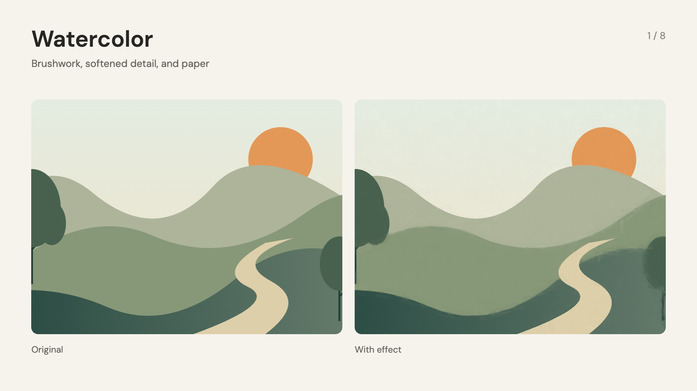

# Add a look to a scene

The kit includes eight effects from Taleframe. They are off until you turn them on. You do not need a Taleframe checkout or its editor.

Start with one effect. Keep interface labels and small text clear: place those elements above the effects layer.



```tsx
import {staticFile} from 'remotion';
import {TaleframeEffects} from '../kit/TaleframeEffects';

<TaleframeEffects
  source={staticFile('my-background.jpg')}
  effects={{watercolor: {enabled: true, amount: 1, paper: 0.4}}}
/>
```

This adds watercolor only. It does not add film grain, stopmotion, or other finishing effects.

| Effect | What it does | Useful controls |
| --- | --- | --- |
| `watercolor` | Rebuilds the image with brushwork and paper | `amount`, `brushSize`, `strokes`, `detail`, `wetness`, `paper`, `seed` |
| `pigment` | Adds color settling and granulation | `amount`, `granulation`, `settling`, `paper`, `seed` |
| `helios` | Keeps a focus area sharp and swirls the blurred surroundings | `blur`, `swirl`, `focusX`, `focusY`, `focusRadius`, `focusFeather` |
| `grain` | Adds a repeatable film texture | `amount`, `size`, `monochrome`, `animated`, `speed`, `blend` |
| `chromatic` | Separates red and blue edges | `strength`, `angle`, `radial`, `redBlue`, `blur` |
| `lens` | Distorts and zooms the image | `distortion`, `zoom` |
| `duotone` | Maps the image to two colors | `amount`, `shadows`, `highlights` |
| `stopmotion` | Holds source frames and optionally adds handmade movement | `fps`, `jitter`, `rotation`, `boil`, `texture`, `exposure`, `seed` |

Use `enabled: true` on each effect you want. Leave other controls out to use the native defaults. `amount: 0` bypasses effects that have an amount control. All seeds are fixed unless you change them.

To combine effects, pass them together. The order runs from first to last:

```tsx
effects={{
  order: ['helios', 'watercolor'],
  helios: {enabled: true, blur: 35, swirl: 0.5},
  watercolor: {enabled: true, paper: 0.4},
}}
```

This blurs the image before painting it, keeping the final brush texture clear. Unlisted effects keep their usual position and remain off unless enabled.

## Animate the source

For moving backgrounds or a canvas scene, pass a draw function. It gets the exact frame and time to draw. Use these values for every animation; do not use `Date.now()` or `Math.random()`.

```tsx
<TaleframeEffects
  source={{draw: (ctx, {width, height, seconds}) => {
    ctx.fillStyle = '#f3eee3';
    ctx.fillRect(0, 0, width, height);
    ctx.fillStyle = '#ca6b4a';
    ctx.beginPath();
    ctx.arc(width * (0.5 + Math.sin(seconds) * 0.2), height / 2, 120, 0, Math.PI * 2);
    ctx.fill();
  }}}
  effects={{stopmotion: {enabled: true, fps: 12, jitter: 0, rotation: 0, boil: 0, texture: 0}}}
/>
```

The source really holds at 12 poses per second. The exported video keeps its normal frame rate. In the draw function, `frame` and `seconds` use this held clock; `outputFrame` is the actual export frame. The handmade texture controls are separate and can all be zero.

The draw function may be async. Load assets before drawing and resolve when the frame is complete. You can composite multiple images or a decoded video frame here. If you already own a canvas renderer, call `applyTaleframeEffects(ctx, effects, frame, fps)` after drawing that frame. Rebuild the source pixels on every call, so effects do not accumulate.

## What is supported

- Images: file URLs from `staticFile`, inline data URLs, or remote images with the right CORS headers. Images fill the frame by default. Use `{src, fit: 'contain', background: '#fff'}` to show the whole image.
- Canvas scenes: the draw function above, including animated images, shapes, and text.
- Video: use the included [video-footage helper](video-sources.md) to extract frames and pass them into this component. The wrapper itself does not decode a movie or capture a DOM video element.
- HTML/React UI: layer it on top to keep it clear. To process it too, first render it into an image or draw the UI into the source canvas.
- Watercolor: native spatial brushwork is included. Taleframe's separate optical-flow analysis for paint that follows objects across video frames is not included. Frame-by-frame video can show changing brush detail; use a gently moving still when that matters.
- Helios: an image effect with a chosen focus region. It does not calculate real scene depth.

Watercolor, pigment, and Helios require WebGL2. Use the kit render script with its configured graphics mode. A missing graphics context produces an error instead of quietly skipping the effect. The simpler finishing passes also have a CPU fallback. Keep source images within the graphics card's texture limit.

The `Effects-Gallery` composition shows each effect beside the original. It runs for 24 seconds: one pair every 3 seconds. Its final scene demonstrates both held movement and surface texture. Check a rendered sample at the final resolution before a long export.

The copied runtime and its source hashes are recorded in `src/taleframe/effects/PROVENANCE.json`. The wrapper uses a small subset of Taleframe's types and sample-time helpers; it does not bring in the editor or project storage.

## Repeatable renders

Use `--gl swangle` when you need the same watercolor pixels after every seek. It uses the portable software graphics path and is slower. Our checks compare a frame, a different source pose, then the original frame again; all eight effects repeat exactly in this mode.

Hardware `--gl angle` is faster. On the tested Mac it produced small differences in watercolor's fine brush passes after a seek. It still renders the same style, but do not use it when exact frame repeatability matters. No effect relies on a wall clock or an unseeded random value.

Run `node scripts/check-effects.mjs` to check native rendering, disabled identity, effect order, held source frames, and error handling on your computer. The report and a sample image are saved in `out/effects-qa`. Set `REMOTION_GL=angle` before the command to test your hardware path.
