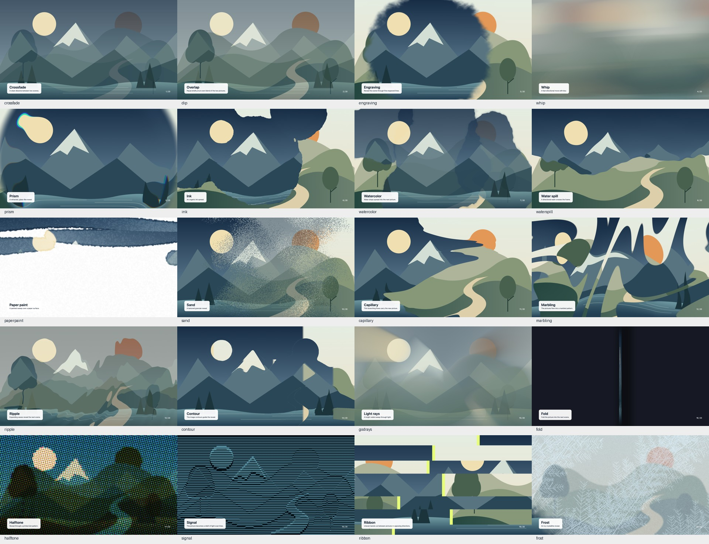

# Taleframe shader transitions

These transitions blend two **pictures**: images, video footage, or canvas drawings. Open **Transition-Gallery** in the preview to see every option. Most of them come from Taleframe's own painted, storybook look (watercolor, ink, paper paint, sand, capillary, marbling, engraving); they suit the handmade style family and footage-driven films.

Between React shots (UI, typography, product scenes) use the [scene transitions](scene-transitions.md) instead: `zoom`, `portal`, `expand`, `slice`, and `glitch` work on live scenes, keep type sharp, and carry motion blur. In either family, cut first and use a designed transition only when it has a reason; see [film language](film-language.md#5-cutting-and-transitions).

The kit includes Taleframe’s native WebGL2 transition shaders. They are bundled here; you do not need to install Taleframe or keep another project on your computer.

## Start with two pictures

Put your pictures in `public/`. This example shows the first picture for half a second, changes to the next picture over one second, then keeps the new picture on screen. It assumes a 60 fps composition.

```tsx
import {staticFile} from 'remotion';
import {TaleframeTransition} from './kit/TaleframeTransition';

<TaleframeTransition
  kind="watercolor"
  from={staticFile('backgrounds/first.jpg')}
  to={staticFile('backgrounds/second.jpg')}
  fromFrame={30}
  durationInFrames={60}
  params={{count: 3, seed: 42}}
/>
```

Use `count: 1`, `2`, or `3` for fewer watercolor drops. Keep the same seed to keep the same pattern. The component fills the composition. Put your UI, cursor, or text **after** it in your scene so those layers remain clear above the background transition.

`fromFrame` is measured inside the surrounding Remotion `Sequence`. The component holds the first picture before that frame and holds the second after the transition. The first and last transition frames are exact endpoints. It does not add frames to your film.

Images use a centered crop by default. You can change that:

```tsx
from={{src: staticFile('first.png'), fit: 'contain', background: '#f6f4ef'}}
```

`fit` can be `cover`, `contain`, or `stretch`. Use a background color behind transparent pictures. These native transitions work with opaque scene pictures; they do not preserve source transparency.

## Choose a style



| `kind` | What it does |
| --- | --- |
| `crossfade` | A clean dissolve |
| `dip` | Hold briefly at an even blend of both pictures |
| `engraving` | Reveal through engraved lines |
| `whip` | A directional camera-like sweep |
| `prism` | A refracted glass reveal |
| `ink` | An organic ink spread |
| `watercolor` | Spreading water drops |
| `waterspill` | A directional wash |
| `paperpaint` | A painted paper sweep |
| `sand` | A granular reveal |
| `capillary` | Thin branching flows |
| `marbling` | Flowing marbled patterns |
| `ripple` | Expanding waves |
| `contour` | A reveal guided by image contours |
| `godrays` | A bright sweep of light rays |

Five earlier Taleframe styles are also included: `fold`, `halftone`, `signal`, `ribbon`, and `frost`. They appear at the end of the gallery. “Earlier” means retired from Taleframe’s current picker, not incomplete.

Each style has its own settings. Your agent can inspect `getTransitionParams(kind)` in `src/taleframe/transitions/registry.ts` for the exact names, ranges, and defaults. The original parameter labels are kept with the native shader source. The gallery and this guide use English names.

The original easing is used by default. Set `ease="linear"` or pass a cubic-bezier tuple such as `ease={[0.22, 1, 0.36, 1]}` when you want to change it. A different curve can change the feel considerably; use the original curve for the closest Taleframe result.

For movie clips, use the included [video-footage helper](video-sources.md) with either source.

## Use an animated canvas as either picture

For motion inside the incoming or outgoing picture, supply a `draw` callback. The kit gives it a fresh, full-size 2D canvas and the exact requested frame. This also works when rendering frames out of order.

```tsx
const outgoing = {
  background: '#f6f4ef',
  draw: (ctx, {frame, fps, width, height}) => {
    const seconds = frame / fps;
    ctx.fillStyle = '#315a7d';
    ctx.beginPath();
    ctx.arc(width * 0.5 + Math.sin(seconds) * 40, height * 0.5, 180, 0, Math.PI * 2);
    ctx.fill();
  },
} satisfies TransitionCanvasSource;
```

Import `TransitionCanvasSource` from the same component file and use `from={outgoing}`. A callback may return a promise; export waits for it. Do not use timers, random values without a seed, or the previous canvas frame. For video, decode the exact requested frame before drawing it in the callback; a playing HTML video is not a frame-accurate source. Arbitrary React children are not automatically captured into these canvases. Render those scenes to image sequences first, or keep their UI above the transitioning backgrounds.

For custom web fonts used by a callback, load the font in your project and pass a font request, for example `fonts={['500 48px "DM Sans"']}`. The render waits for both font and image loading. Missing media, missing requested fonts, unsupported names, and WebGL errors stop the export with a useful error rather than silently producing a different picture.

## Render and check

Use the included render script, which enables Chromium software WebGL2 by default. Start with a few gallery stills, then check a short video on your machine. GPU drivers can cause small pixel differences across systems. Every transition uses frame time and fixed seeds, so seeking within the same environment remains repeatable.

The source record is `src/taleframe/transitions/PROVENANCE.json`. All 20 transition module files are copied exactly from the recorded Taleframe snapshot. The surrounding host, types, registry, and easing imports were adapted to work independently and report render errors.
